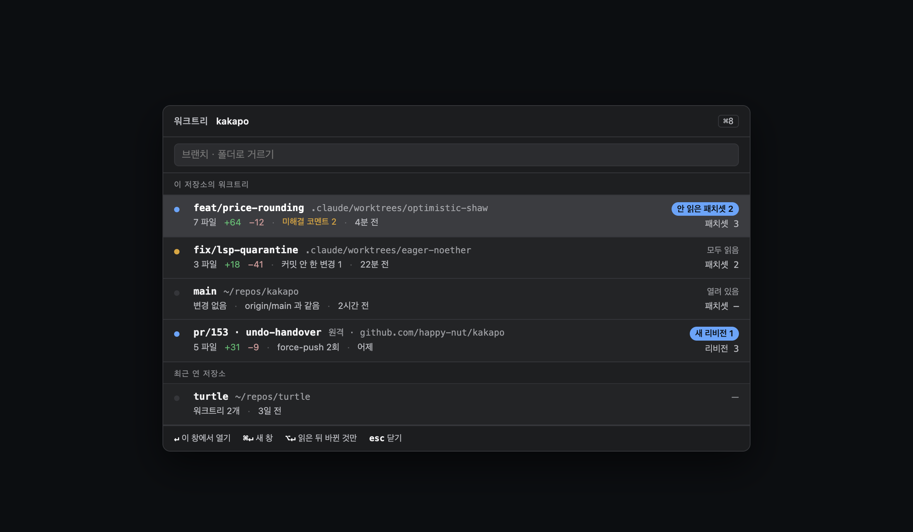
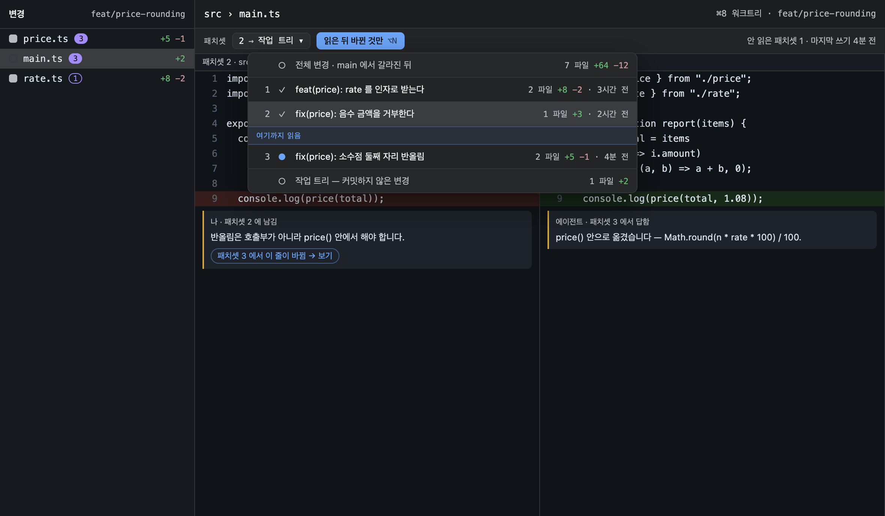

# 워크트리 · 패치셋 리뷰 설계

작성 2026-11-16. 이 문서는 kakapo 의 주 워크플로우를 한 문장으로 못 박고, 그 문장에 어긋나는 지금의
간격을 **실측과 함께** 적고, 무엇을 어떤 순서로 바꿀지 정한다. 추측과 측정값을 섞지 않는다 — 측정한
것은 수치를 적었고, 아직 확인하지 않은 것은 "미확인"이라고 적었다.

## 0. 전제하는 워크플로우

> 에이전트가 워크트리를 만들어 그 안에서 일한다. kakapo 는 **각 워크트리에서 띄우거나 원격 PR 을
> 가져와서**, 사람이 **패치셋 단위로** 변경을 읽는다.

여기서 나오는 단위 세 개가 이 앱의 뼈대다.

| 단위 | 뜻 | 누가 만드나 |
| --- | --- | --- |
| 워크트리 (또는 PR) | 한 과제 | 에이전트 |
| 패치셋 | 그 과제 안의 한 턴 — 커밋 하나, 또는 force-push 한 번 | 에이전트 |
| 리뷰 | 사람이 읽은 범위와 남긴 말 | 사람 |

루프는 이렇다: **에이전트가 쓴다 → 사람이 새로 온 것만 읽는다 → 코멘트를 남긴다 → 에이전트가
고친다(= 새 패치셋) → 사람이 그 델타만 읽는다.**

kakapo 가 책임지는 것은 이 루프의 **읽는 쪽**뿐이다. 워크트리를 만들거나 지우지 않고, 에이전트를
돌리지 않는다 (AGENTS.md). 이 설계는 그 경계를 넘지 않는다 — 워크트리를 **열거**하되 **관리**하지
않는다.

## 1. 지금 상태 (2026-11-16 측정)

### 1.1 워크트리는 앱에 존재하지 않는다

`git worktree` 를 읽는 코드가 하나도 없다. `src/app-main.ts:614` 의 주석이 `open-worktree` 라는
채널을 언급하지만 그 채널은 지금 없다 — 허브/레일을 걷어낼 때 같이 사라졌다. 지금 워크트리 다섯 개를
읽으려면 터미널에서 `kakapo` 를 다섯 번 치고 서로 관계 없는 창 다섯 개를 얻는다. 환영 화면의 최근
목록은 **경로 문자열의 평평한 나열**이다 — 브랜치도, 앞선 커밋 수도, "2분 전에 에이전트가 썼다"도
없다.

### 1.2 워크트리 하나가 실제로 드는 값 (실측)

이 레포(TypeScript, 324 파일)를 dev 앱으로 열고 `ps` 로 잰 값:

| 상태 | 프로세스 | RSS 합 | 언어 서버 |
| --- | --- | --- | --- |
| 워크트리 1개, 분석 warm | 8 | **1,500 MB** | 3개 / 576 MB |
| 같은 레포의 워크트리 2개, 둘 다 warm | 13 | **2,276 MB** | 6개 / 1,012 MB |

**같은 레포의 두 번째 워크트리가 +776 MB.** 그중 436 MB 는 *거의 같은 코드*를 다시 인덱싱하는
중복 언어 서버다. `LSP_TOTAL_BUDGET_MB` 는 2,400 MB — 즉 **TypeScript 레포의 워크트리를 세 개
열면 이미 전역 예산을 넘어** 식은 fleet 부터 회수되기 시작한다. 회수된 워크트리로 돌아가면 warm-up
을 다시 낸다.

이 수치가 이 설계의 성능 절반을 결정한다. 키 입력 지연이 아니라 **워크트리당 고정비**가 문제다.

> 2026-11-16 보정: 창을 합쳐 이 고정비를 피하는 길(§3 A, §6 D1)은 철회됐다 — 워크트리마다 창
> 하나가 정상이다. 남은 고정비 중 kakapo 가 실제로 없앨 수 있는 것은 **자기가 다시 하는 계산**
> 이고, 그게 §6 D0 이다. 언어 서버가 자기 인덱스를 다시 만드는 값은 kakapo 가 캐시할 수 없다 —
> 그건 그 프로세스의 것이다.

### 1.3 패치셋 바는 숫자만 있다


`PATCH SETS  BASE [All][1][2][3] … 요약 … [1][2][3][WT]  TARGET`

- 숫자는 아무것도 말하지 않는다. 제목·시각·파일 수는 **호버해야** 나온다.
- 같이 쓰는 컨트롤 두 개(BASE/TARGET)가 창 양 끝에 있다. 3456px 창에서 1,800px 떨어져 있다.
- **어디까지 읽었는지 표시가 없다.** "내가 본 뒤에 뭐가 왔나"는 이 워크플로우의 제1 질문인데,
  답하려면 내가 몇 번에서 멈췄는지를 기억해 두 번 클릭해야 한다.
- 파일 목록의 `+2 / +3 −2` 는 어느 패치셋이 건드린 것인지 말하지 않는다.

패치셋 전환 비용 (실측, 3-파일 데모 레포 / 324-파일 kakapo 레포):

| 측정 | 값 |
| --- | --- |
| `buildDiffReview` (앱 경로, lazyLoad+app) | 100–230 ms |
| 렌더러에 가는 update 페이로드 | 0.11–0.13 MB |
| 클릭 → DOM 안정까지 (데모 레포) | ~500 ms |

페이로드는 문제가 아니다 (lazyLoad 에서 content/image 가 빠진다 — `src/build.ts:222`).
전환 1회 = 빌드 1회이며 중복 빌드는 없다 (연속 클릭이 watch tick 과 겹칠 때만 두 번 돈다).
500 ms 중 빌드 밖의 몫에는 전환마다 올라가는 **분석 generation 과 indexing→ready 깜빡임**이 섞여
있다 — `analysis-index-sync` 가 `outcome:"unchanged"` 로 돌아오는데도 그렇다. (여기까지 실측,
원인 분해는 미확인.)

### 1.4 원격 PR 은 반만 된다

`⌥L` 은 `gh pr view` 로 base/head **이름**만 알아내고, 그 head 가 **이미 로컬에 있어야** 한다
(`src/github-pr.ts`). 없으면 가져오지 않고 보고한다 — "남의 저장소에 쓰지 않는다"는 약속 때문이다.
그래서 "원격에 있는 PR 을 가져와서"는 지금 `git fetch` 를 사람이 먼저 친 경우에만 성립한다.
그리고 PR 의 패치셋(= force-push 리비전)은 개념 자체가 없다.

### 1.5 이미 잘 되어 있는 것 (건드리지 않는다)

- 파일별 **viewed 표시가 그 파일의 패치 서명으로 저장된다** (`01-core.js:1339`) — 파일이 바뀌면
  자동으로 다시 "안 읽음"이 된다. 증분 리뷰의 절반은 이미 있다.
- 코멘트는 `.git/worktrees/<id>/kakapo/comments.jsonl` 에 평문으로 있고, 에이전트가 그 파일에
  한 줄 덧붙여 답하면 그 카드 위에 뜬다 (`23-agent-cards.js`). 루프의 돌아오는 길은 이미 있다.
- 첫 페인트는 diff-first (바뀐 파일만 인덱싱) 이고, fleet 은 요청이 올 때까지 뜨지 않는다.

## 2. 설계 원칙

0. **진입은 터미널이다.** 사람은 작업 중인 워크트리의 터미널에서 `kakapo` 를 친다. 앱은 그 자리를
   뺏지 않는다 — 그러므로 비용은 "창을 적게 쓰는 것"이 아니라 **띄울 때마다 적게 계산하는 것**으로
   깎는다 (§6 D0). (2026-11-16 사용자 결정, §3)
1. **읽되 관리하지 않는다.** 워크트리를 나열하되 만들거나 지우지 않는다.
2. **리뷰 대상 저장소에 쓰지 않는다.** PR 을 가져와야 하면 kakapo 자신의 userData 미러로 가져온다.
3. **한 사실에 읽는 곳 하나** (AGENTS.md). 워크트리 목록·패치셋 목록·읽은 지점은 각각 접근자 하나.
4. **숫자는 뜻을 지고 있어야 한다.** 패치셋은 에이전트의 한 턴이다 — 제목·시각·규모·읽음 여부를
   버튼 위에 적는다.

## 3. A — 워크트리 전환기 (⌘8) — **철회 (2026-11-16)**

> 사용자: "나는 워크트리를 카카포 안에서 전환하고 싶지 않은데 별로. 작업 중인 워크트리의 터미널에
> 가서 보통 `kakapo` 라는 cli 명령을 치는 식으로 쓸 거 같아."

진입 지점은 **워크트리의 터미널**이다. 앱 안의 전환기는 그 자리를 뺏으려는 설계였고, 그래서
철회한다. 이 결정은 성능 설계를 통째로 뒤집는다:

- 전환기가 없으면 **창을 재사용해 고정비를 아끼는 길도 없다** (§6 D1 도 같이 철회). 워크트리마다
  창이 하나씩 생기는 것은 이 워크플로우에서 정상이다.
- 그러면 깎아야 할 것은 "N개 창의 합"이 아니라 **창 하나가 뜰 때마다 다시 하는 계산**이다.
  → §6 D0.

아래 목록 설계는 기록으로 남긴다 (행이 무엇을 져야 하는지는 패치셋 원장 §4 에서 그대로 쓴다).



행 하나가 지고 있는 것:

```
● feat/price-rounding      worktrees/optimistic-shaw     패치셋 3  ·  2개 안 읽음
  +64 −12 · 7 파일 · 미해결 코멘트 2 · 4분 전
```

- **브랜치**와 폴더 이름 (둘 다 필요하다 — 에이전트 워크트리는 이름이 자동 생성이라 브랜치가
  정체를, 폴더가 위치를 말한다)
- 기준점 대비 **패치셋 수**, 그중 **내가 읽은 뒤 생긴 수** (§4 의 읽음 지점에서 계산)
- 변경 규모, **미해결 코멘트 수** (그 워크트리의 `comments.jsonl` 을 읽으면 나온다 — 이미 경로를
  안다), **마지막 쓰기 시각**
- 더티 여부

동작:

- `Enter` = **지금 창에서 연다.** 새 창이 기본이 아니다 — §1.2 의 +776 MB 가 그 이유다.
- `⌘Enter` = 새 창. 두 워크트리를 나란히 놓고 비교할 때만 값을 낸다.
- 이미 열린 워크트리면 그 창에 포커스 (지금의 `openOrFocusWorkspace` 그대로).

데이터는 전부 디스크에 있으므로, 다른 워크트리를 읽는 동안에도 이 목록의 "안 읽음"은 계속 자란다.
만드는 버튼도, 지우는 버튼도 없다.

## 4. B — 패치셋을 '원장'으로

숫자 열 두 줄을 **목록 하나**로 바꾼다. 바는 남기되, 바의 숫자는 목록의 요약이 된다.



```
  기준  ────────────────────────────────────────────────────
  ○  전체 변경 · main                      7 파일  +64 −12
  ●  1  feat(price): rate 를 인자로        2 파일  +8  −2    3시간 전   읽음
  ●  2  fix(price): 음수 거부              1 파일  +3  −0    2시간 전   읽음
  ▸  3  fix(price): 소수점 둘째 자리 반올림 2 파일  +5  −1    4분 전     ← 안 읽음
  ○  작업 트리 (저장했지만 커밋 안 한 것)   1 파일  +2  −0
```

- **읽음 지점**: 워크스페이스 `state.json` 에 `lastReadPatchSet`(sha) 하나를 둔다. 그보다 새로운
  패치셋은 "안 읽음". 이 한 값이 §3 의 "2개 안 읽음" 과 아래 버튼을 동시에 먹인다 — 한 사실에
  읽는 곳 하나.
- **「읽은 뒤 바뀐 것만」 버튼 하나**: base=lastRead, target=HEAD. Gerrit 의 "patch set N 이후"
  를 두 번 클릭이 아니라 한 번으로. 이 워크플로우에서 가장 자주 누를 버튼이다.
- base/target 직접 지정은 남기되 **붙여 놓는다**. 지금은 1,800px 떨어져 있다.
- 파일 목록의 행에 **어느 패치셋이 건드렸는지** 점을 찍는다 (`3` 에서 바뀐 파일만 하이라이트).

## 5. C — 코멘트 ↔ 패치셋 왕복

코멘트를 저장할 때 **그때의 패치셋 sha** 를 같이 적는다 (`comments.jsonl` 에 필드 하나). 그러면:

- 카드에 "패치셋 2 에 남김" 이 뜬다.
- 그 파일·그 줄을 **더 새로운 패치셋이 건드리면** 카드에 「패치셋 3 에서 바뀜 → 보기」 가 붙고,
  누르면 base=2, target=3 으로 그 파일만 연다.
- 에이전트가 `comments.jsonl` 에 답을 덧붙이면 (이미 되는 것) 그 답이 **어느 리비전에서 한 답인지**
  가 함께 보인다.

(§4 의 목업 오른쪽 절반이 이 왕복이다 — 코멘트에 「패치셋 2 에 남김」, 그 아래 「패치셋 3 에서 이
줄이 바뀜 → 보기」, 반대쪽에 「에이전트 · 패치셋 3 에서 답함」.)

이게 루프를 닫는 조각이다. 지금은 에이전트의 답을 **글로만** 읽는다 — 이 설계에서는 **diff 로** 읽는다.

## 6. D — 성능: 띄울 때마다 다시 하는 계산을 없앤다

§3 의 철회로 기준이 바뀌었다. 깎을 것은 창의 **개수**가 아니라 창 하나를 **띄우는 값**이다.

### D0. 심볼 스캔을 launch 사이에 남긴다 — **구현됨 (2026-11-16)**

`buildProjectIndex` 는 매 launch 마다 트리를 다시 걷고, 모든 파일을 다시 읽고, 모든 줄을 다시
스캔한다. 셋 중 스캔이 거의 전부다 (실측):

| 레포 | 파일 | 걷기 | 읽기 | **스캔** |
| --- | ---: | ---: | ---: | ---: |
| kakapo | 294 | 21 ms | 24 ms | **228 ms** |
| zoobox | 3,513 | 30 ms | 242 ms | **2,661 ms** |
| rea-clone | 5,551 | 23 ms | 260 ms | **2,517 ms** |

그래서 **파생된 절반만** 남긴다 (`src/analysis-cache.ts`). 내용은 어차피 읽어야 하므로(인덱스가
usage 스캔용으로 들고 있다) 읽기는 남기고, 스캔 결과만 저장한다.

**키는 경로가 아니라 내용이다.** `indexOneFile` 이 경로에 의존하는 지점은 확장자뿐 — `maskNonCode`
의 주석 문법과 `.py` 의 컨테이너 패스. 그래서 `(확장자, 내용)` 해시 하나가 그 텍스트가 어디에
있든 유효하고, 이것이 이 워크플로우의 핵심이다:

- 에이전트가 방금 만든 워크트리는 메인 체크아웃과 **0.3–3%** 만 다르다 (3개 레포 실측).
  저장소는 레포 단위(`commonGitDir`)라 **형제 워크트리가 메인의 스캔을 그대로 받는다.**
- 이름만 바뀐 파일은 새 파일이 아니다. 리비전을 읽을 때도 같은 저장소가 답한다.
- 경로로 키를 잡았다면 리비전이 다른 두 워크트리가 서로의 항목을 덮어써서 둘 다 계속 빗나간다.

저장하는 것은 레코드의 일부뿐이다 — `declaration`·`text` 는 둘 다 `lines[lineIndex]` 이고 `path`
는 지금 읽는 파일이다. 그래서 180k 심볼이 6 MB 다.

실측 (`buildProjectIndex` 전 경로, 만들어진 인덱스는 **심볼 단위로 동일**함을 확인):

| 레포 | 지금 | 저장소 있음 | |
| --- | ---: | ---: | ---: |
| kakapo | 246 ms | **41 ms** | 5.9× |
| zoobox | 2,768 ms | **349 ms** | 7.9× |
| rea-clone | 2,763 ms | **398 ms** | 6.9× |
| kakapo 의 형제 워크트리 (HEAD~2) | 238 ms | **63 ms** | 3.8× · 적중 98% (6개만 스캔) |

첫 launch 는 해싱·쓰기로 ~10% 느려진다 (246→272 ms, 2,768→3,009 ms). 그 값을 치르는 것은 한 번뿐이다.

실제 앱에서 확인한 것 (dev 빌드, 이 레포를 두 번 띄움 — perf 트레이스의 `analysis-status`):

```
1회차  948.9 ms  phase:"ready"   cacheHits:0    cacheMisses:240 → 296 (저장소 437 KB, 296 항목)
2회차 1222.1 ms  phase:"ready"   cacheHits:296  cacheMisses:0            ← 스캔한 파일 0개
```

그리고 2회차의 그 인덱스에 실제로 질문했을 때 (`kakapoAnalysis.query`, `workspaceSymbol`):

```
engine:"index"  →  src/viewer/11-render-http.js:22 openSourceFile [function]
                   test/helpers/dom.mjs:516        openSourceFile [method]
```

`method` 와 `function` 의 구별까지 저장된 레코드에서 되살아난다 — 세어 본 것이 아니라 **답하게 해
본 것**이다.

무효화는 손으로 올리는 버전이 아니라 **스캐너 자신의 소스 지문**이다 (`analysis-index.js` 의
해시). 선언 패턴을 하나 고치면 저장소 전체가 그 자리에서 무효가 된다 — 개발 빌드 포함. 파생값
캐시에서 틀린 레코드는 "느린" 게 아니라 **없는 줄로 점프하는** 것이라 이 레포가 가장 싫어하는
종류의 오답이고, 사람이 기억해야 하는 무효화는 언젠가 잊힌다.

### D1. 전환은 창을 늘리지 않는다 — **철회 (2026-11-16)**
§3 과 함께 철회. 워크트리마다 창 하나가 이 워크플로우의 정상 상태다.

### D2. 떠난 fleet 에 유예를 준다
지금은 창을 바꾸면 전 워크트리의 fleet 이 바로 회수되거나(예산 초과 시) 30분 유휴를 기다린다.
워크트리를 오가는 이 워크플로우에서는 **60초 유예**가 맞다 — 돌아오는 게 흔하다. 기계는 이미 다
있다 (`recycleFleet` / `analysisSuspended` / 가중치 감시). 상한은 기존 2,400 MB 예산이 지킨다.

### D3. 같은 레포의 형제 워크트리는 서버를 나눠 쓸 수 있는지 본다 (조사 항목)
메모리에 남은 "레포당 LSP 풀링 거부" 판단은 **한 루트 = 한 창**이라는 전제 위에 있었다. 이
워크플로우는 그 전제를 깬다 — 같은 레포의 워크트리 N개가 거의 같은 코드를 N번 인덱싱한다
(실측 436 MB 중복). 다만 tsserver/pyright 는 루트 경로에 묶이므로 "그냥 공유"는 안 된다.
**먼저 재야 할 것**: 두 워크트리의 인덱스가 실제로 얼마나 겹치는지, 서버를 하나 띄워 두 루트를
workspace folders 로 주는 길이 각 서버에서 되는지. 되면 D1 다음으로 큰 몫이고, 안 되면 D2 로 만족한다.

### D4. 패치셋 전환에서 분석을 흔들지 않는다
전환은 base/target 만 바꾼다 — **소스 인덱스가 그대로인 전환**에서는 `analysis.invalidate()` /
재동기화를 건너뛴다. `outcome:"unchanged"` 가 이미 그 사실을 말하고 있는데도 generation 이
올라가고 상태 칩이 indexing→ready 로 깜빡인다. (몫은 미확인 — D4 를 하기 전에 그 깜빡임이
500 ms 중 얼마인지부터 잰다.)

### D5. 원격 PR 은 kakapo 자신의 미러로 가져온다
`refs/pull/<n>/head` 를 리뷰 대상 저장소가 아니라 **userData 아래 kakapo 의 bare 미러**로 fetch
한다. 원칙 2를 지키면서 §1.4 의 반쪽을 메운다. PR 의 패치셋은 미러에 쌓인 리비전들 — force-push
해도 이전 리비전이 미러에 남으므로, GitHub 이 못 보여 주는 "force-push 전후 diff" 를 kakapo 는
보여 줄 수 있다. (이 워크플로우에서 꽤 큰 차별점이다.)

## 7. 단계

| 단계 | 내용 | 끝났다는 증거 |
| --- | --- | --- |
| ~~1~~ | ~~A 워크트리 전환기 + D1 창 재사용~~ | **철회** (§3) |
| 1 | **D0 심볼 저장소** | **완료** — 두 번째 launch 의 perf 트레이스가 `cacheHits:296, cacheMisses:0`, 그 인덱스가 `engine:"index"` 로 심볼 질문에 답함 |
| 2 | B 패치셋 원장 + 읽음 지점 + 「읽은 뒤 바뀐 것만」 | 에이전트가 커밋 하나 더 쌓았을 때 1클릭으로 그 델타만 열림 |
| 3 | C 코멘트↔패치셋 왕복 | 코멘트 남긴 뒤 에이전트 수정 → 카드에서 그 diff 로 점프 |
| 4 | D6 리뷰 빌드 건너뛰기 (아래) | 바뀐 것이 없는 launch 가 빌드를 하지 않음 |
| 5 | D5 PR 미러 + PR 패치셋 | `kakapo pr <n>` 이 로컬 ref 없이 열림 |

### D6. 리뷰 빌드도 건너뛸 수 있다 — 아직 안 한다 (판단 기록)

launch 마다 리뷰 빌드가 다시 돈다: 실측 145 ms (kakapo) · 242 ms (zoobox) · 780 ms (rea-clone).
그리고 그것을 건너뛸 열쇠는 이미 있다 — `reviewDiffSignature` 는 빌드 전에 부른 값이 빌드가 내놓는
`watchSignature` 와 **같다**는 것을 세 레포에서 확인했고, 비용은 빌드의 1/5–1/20 이다.

안 하는 이유는 무효화 입력이 하나가 아니라 **셋**이기 때문이다: diff 내용(위 서명이 답한다),
리뷰 옵션(`--context`·공백 무시 등 — `git diff --raw` 는 이것들에 반응하지 않는다), 그리고
**인라인된 뷰어 번들**(앱이 업데이트되면 디스크의 HTML 은 옛 UI 다). 셋 중 하나를 빠뜨리면 증상은
"어제 diff 를 보여 준다"이고, 이 레포는 이미 그 종류의 버그를 한 번 치렀다
(`project_kakapo_stale_diff_watch_baseline`). D0 의 7–22× 에 비해 몫은 5–18% 이므로, 순서상 뒤다.

### launch 하나가 다시 하는 계산, 전부 (실측 정리)

| 무엇 | kakapo | zoobox | rea-clone | 상태 |
| --- | ---: | ---: | ---: | --- |
| 심볼 스캔 (`buildProjectIndex`) | 246 ms | 2,768 ms | 2,763 ms | **D0 로 41 / 349 / 398 ms** |
| 리뷰 빌드 (`writeReviewWorkspace`) | 145 ms | 242 ms | 780 ms | D6 — 보류 (위) |
| 전체 프로젝트 인덱스 (`collectReviewSourceIndex`) | 128 ms | 650 ms | 553 ms | 첫 ⌘O 때 한 번, 같은 무효화 문제 |
| 언어 서버 자기 인덱스 | — | — | — | **kakapo 의 것이 아니다** (그 프로세스가 다시 한다) |

각 단계는 기존 규율을 그대로 받는다: 단축키는 `src/shortcuts.ts` 한 줄 + `i18n.ts` 양쪽 로케일 +
`SHORTCUT_ACTIONS`, 메뉴 충돌은 `test/menu-accelerators.test.mjs`, 한 사실에 읽는 곳 하나는
`test/viewer-slices.test.mjs`.

## 8. 일부러 하지 않는 것

- 워크트리 **생성·삭제·정리**. 에이전트 하네스가 할 일이다 (AGENTS.md).
- 에이전트 실행, 터미널 내장, 워크스페이스 매니저. 전에 일부러 걷어낸 것들이다.
- 리뷰 대상 저장소에 ref·파일 쓰기. D5 가 미러를 쓰는 이유.
- PR 코멘트를 GitHub 에 올리기. 코멘트는 로컬에 남고 `gh` 는 읽기 전용이다 (기존 방향).
